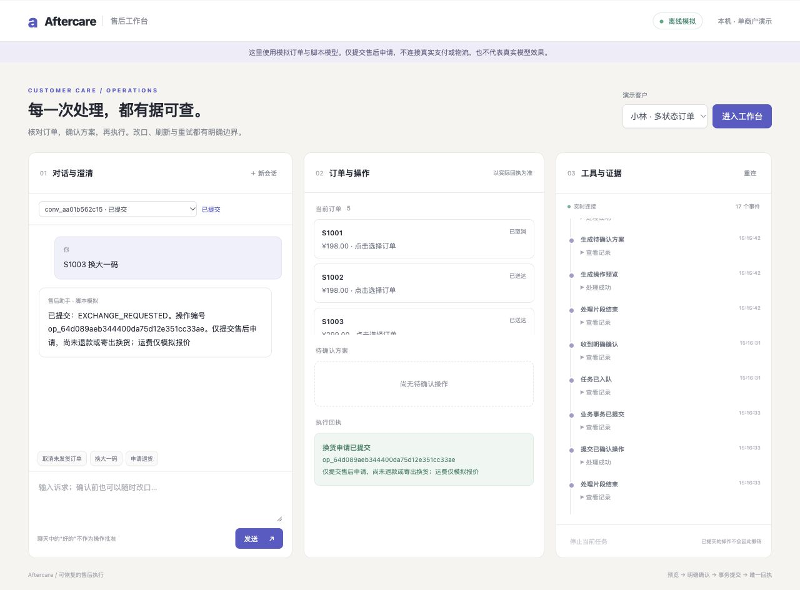

# 电商售后多轮决策与执行 Agent 工作台

已完成阶段 0—5：可运行三栏工作台、单主 Agent 工具循环、可信确认、真实 PostgreSQL 原子提交、幂等恢复、政策检索与任务队列。
默认是明确标记的**脚本模拟模式**，没有真实对话模型效果或生产成功率。



## 运行

```bash
cd /Users/gehanyang/编程/aftercare-agent-workbench
docker compose up -d db
.venv/bin/python -m aftercare db migrate
.venv/bin/python -m aftercare demo seed --database demo
.venv/bin/python -m aftercare serve --offline
# 第二终端
.venv/bin/python -m aftercare worker --provider scripted
```

打开 http://127.0.0.1:8000。当前已启动的容器工作台在 http://127.0.0.1:8128。
可体验“S1002 换大一码”、确认前改口、刷新/重连。取消只记录模拟退款请求，退换仅提交申请，不声称到账或寄出。

[操作说明](docs/operations.md)提供 Docker、重置、故障演示、依赖重建与验证命令。
[业务契约](docs/business-contract.md)、[架构](docs/architecture.md)、[决策](docs/decisions.md)、
[资源清单](docs/resources.md)、[阶段交接](docs/handoffs/)保留实现与验证边界。

阶段 0—5 禁止真实模型调用；阶段 6 必须另行批准精确模型、场景、请求数、Token 上限与停止条件。
阶段 5 已交付 60 条开发场景、100 条独立验收场景的公开 manifest、独立评分器和冻结清单。
独立答案未由实现角色读取或运行；开发脚本通过不代表真实模型成功率。

```bash
.venv/bin/python -m aftercare eval validate --split dev
.venv/bin/python -m aftercare eval run --split dev --provider scripted
.venv/bin/python -m aftercare eval verify-grader
.venv/bin/python -m aftercare eval plan --batch compatibility-smoke --dry-run
```

[评测说明](evaluation/README.md) · [开发结果](docs/experiments/development-final.md) ·
[阶段 5 交接](docs/handoffs/phase-05.md) · [真实试跑待批计划](evaluation/manifests/compatibility-smoke.json)


阶段 6A compatibility-smoke 已完成：精确模型 qwen3.5-plus-2026-02-15，6/6 协议检查通过，
6 次真实请求、0 重试，输入 1,001 / 输出 101 Token，未知预留 0，耗时 13.933 秒。
这不等于真实售后 Agent 评测；当前工作台仍为脚本模拟。
[实际兼容报告](docs/experiments/compatibility-smoke.md) ·
[6A 交接](docs/handoffs/phase-06A-compatibility-smoke.md) ·
[下一批待批计划](evaluation/manifests/development-pilot.json)。
