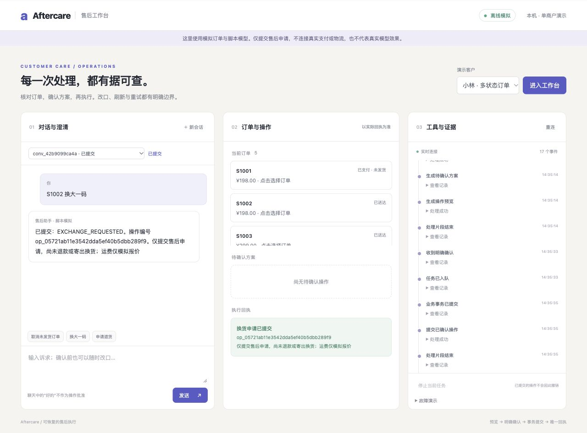

# 电商售后多轮决策与执行 Agent 工作台

已完成阶段 0—4：可运行三栏工作台、单主 Agent 工具循环、可信确认、真实 PostgreSQL 原子提交、幂等恢复、政策检索与任务队列。
默认是明确标记的**脚本模拟模式**，没有真实对话模型效果或生产成功率。



## 运行

```bash
cd /Users/gehanyang/编程/aftercare-agent-workbench
docker compose up -d db
.venv/bin/python -m aftercare db migrate
.venv/bin/python -m aftercare demo seed --database demo
.venv/bin/python -m aftercare serve --offline
# 第二终端
.venv/bin/python -m aftercare worker --provider scripted
```

打开 http://127.0.0.1:8000。当前已启动的容器工作台在 http://127.0.0.1:8128。
可体验“S1002 换大一码”、确认前改口、刷新/重连。取消只记录模拟退款请求，退换仅提交申请，不声称到账或寄出。

[操作说明](docs/operations.md)提供 Docker、重置、故障演示、依赖重建与验证命令。
[业务契约](docs/business-contract.md)、[架构](docs/architecture.md)、[决策](docs/decisions.md)、
[资源清单](docs/resources.md)、[阶段交接](docs/handoffs/)保留实现与验证边界。

阶段 0—5 禁止真实模型调用；阶段 6 必须另行批准精确模型、场景、请求数、Token 上限与停止条件。
阶段 5 评测资产尚在建设，不把测试数、脚本流程通过或模型卡数字写成真实业务任务成功率。
