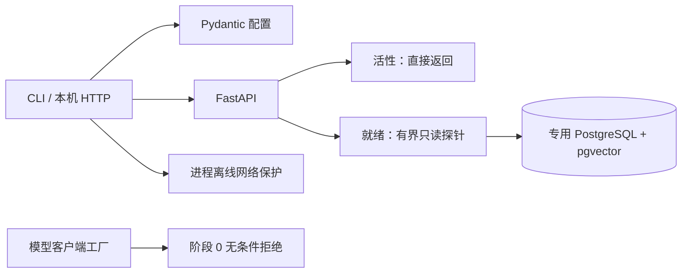

# 架构与阶段边界

当前已运行：配置 → CLI → FastAPI 活性接口；就绪探针 → PostgreSQL 连接/pgvector/迁移版本。
阶段 0 readiness 仅表示基础设施，不表示售后功能已完成。

最终数据流（阶段 1—5 按序实现）：
用户消息 → 服务端 principal → 消息去重/递增意图版本/旧预览失效 → 数据库队列 → 单 worker →
Deep Agents 主图 → 校验工具白名单 → 业务服务/政策检索 → 预览 → 持久化等待可信确认 →
事务提交 → 唯一 operation 回执/审计 → SSE 重放和三栏工作台。

业务 PostgreSQL 是订单/申请/库存/授权/预算/事件的唯一事实来源；LangGraph Postgres checkpoint
仅负责线程执行位置和中断恢复，不能替代业务事务。应用和 worker 共享数据库，无 Redis/Celery。
检索采用 BM25 + 可选固定 revision 本地模型，未授权下载前不声称 dense/rerank 语义验收。

## 模块责任

- config.py：验证环境变量、隐藏敏感值；加载不建客户端。
- cli.py/offline.py：默认本机监听、显式入口安装离线保护、返回可判定退出码。
- api/app.py：构建应用不联网；live 无依赖；ready 真实检查数据库并返回 503。
- repositories/database.py：连接 2 秒/SQL 2 秒超时，检查 vector 与 baseline revision，不输出 DSN。
- llm/gateway.py：阶段 0 无条件阻止创建真实客户端；阶段 3 接入统一预算，阶段 6 另验授权。

## 当前未实现

业务表/用户会话/业务 API、检索、Agent 图、预算账本、worker、三栏 Web、SSE 和评测器均在后续阶段。
Compose 的 app/db 可定义启动，worker 服务待阶段 4 提供真实入口时加入；不设置伪 worker 常驻命令。
离线 audit hook 是 Python 进程保护而非操作系统隔离；普通 pytest 另用 pytest-socket 默认禁外部网络。
本机数据库连接允许，启动、诊断和导入没有任何推理路径。
