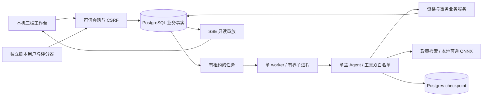

# 架构与阶段边界

当前完成阶段 0—5 的离线工程；真实主模型、真实用户模型和生产服务均未验证。
FastAPI + PostgreSQL/pgvector + 单 worker + Deep Agents 主图；无 Redis/Celery 或通用子 Agent。

消息入库、意图版本递增、旧预览失效和 job 入队在同一事务。worker 获取会话锁与租约，
将原始当前消息传给图；工具参数严格验证，principal 在服务端闭包内注入。
资格与政策版本由服务校验。预览只读，不预占库存；图在 commit 前持久化中断。
可信确认与唤醒入队也同事务；最终提交重新检查版本、资格、批准和库存，原子写申请/预留/回执。
SSE 的 cursor 仅重放已有事件，不执行 Agent。界面成功状态来自 operation，不能来自模型的一句文本。

业务 PostgreSQL 是订单、申请、库存、授权、预算、事件的事实来源。checkpoint 只记录执行位置。
响应丢失先按原 preview/operation 查回执；重复消息、重复确认和事件重放有不同的去重键。
服务层事务与唯一约束保证重启前后操作一致，而非依赖图“恰好只执行一次”。

## 模块责任

- api / web：会话、同源/CSRF、三栏、可信确认、SSE、实际回执；演示身份不等于生产认证。
- workers：数据库队列、会话锁、owner/租约、硬截止、取消；子进程终止后未知 usage 保留预留。
- agent / llm：9 项白名单工具、参数校验、有效状态、持久化 HITL、统一预算与离线脚本模型。
- services / repositories：业务资格、小时边界、整数分、版本化政策、行锁/唯一约束和审计。
- retrieval：资格/流程版本前置筛选，BM25/dense/RRF/rerank 对照，固定权重 revision，无远程推理。
- evaluation：产品包之外的 schema、60 dev、脚本用户、子进程 actor、独立原始行评分和报告。

四种评测 profile 共享业务保护；完整历史/全文政策基线保留强上下文，full 另使用结构化有效状态与有界恢复。
产品镜像不含 evaluation、runtime、原始轨迹、权重或 Key；默认容器 BM25，宿主机可运行 ONNX 对照。
独立角色另存 100 条 holdout，当前实现角色只读取无答案 manifest；同机工作流隔离不是宿主机访问控制。

## 已验证与边界

阶段交接与 docs/experiments 记录实际证据；测试全用 PostgreSQL，不以 SQLite 替代事务验收。
离线开发任务成功只证明规则脚本和这些输入下的工程行为，不表示自由表达质量、真实 Token 或收益。
Bailian 适配器已测请求形状，但执行入口仍无条件禁止；环境开关不能单独授权。
Python 网络 hook 和 pytest-socket 是进程保护，不是操作系统级沙箱。
下一阶段先审批精确模型、场景/请求、次数、Token、时间、停止条件与计划 hash。
